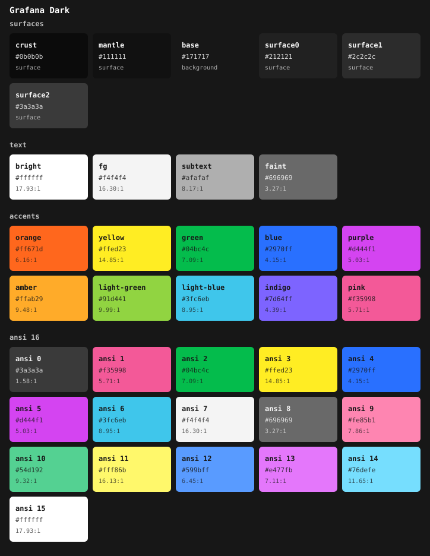
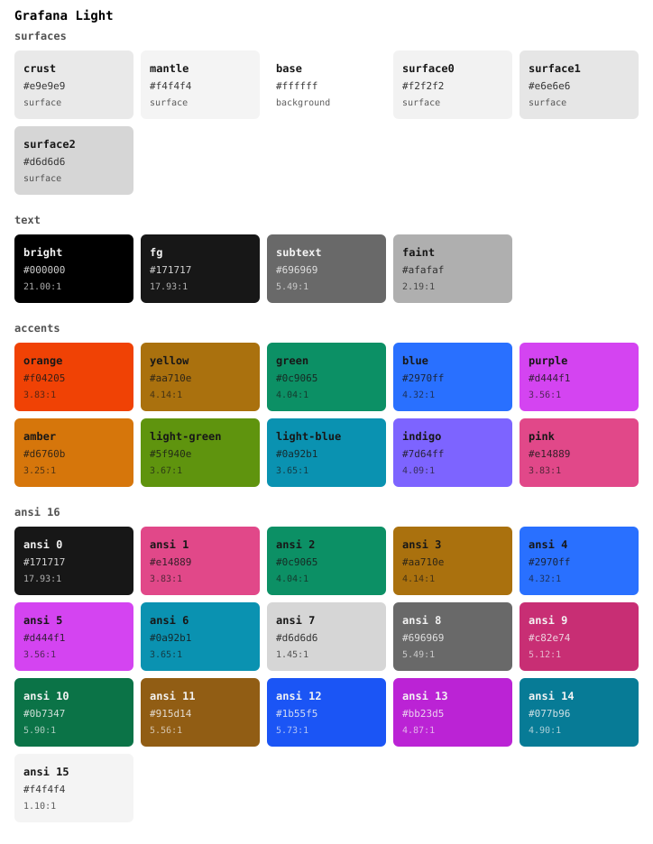
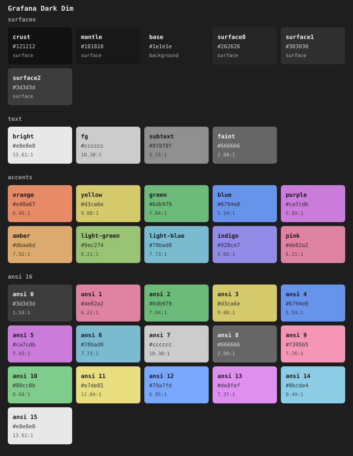
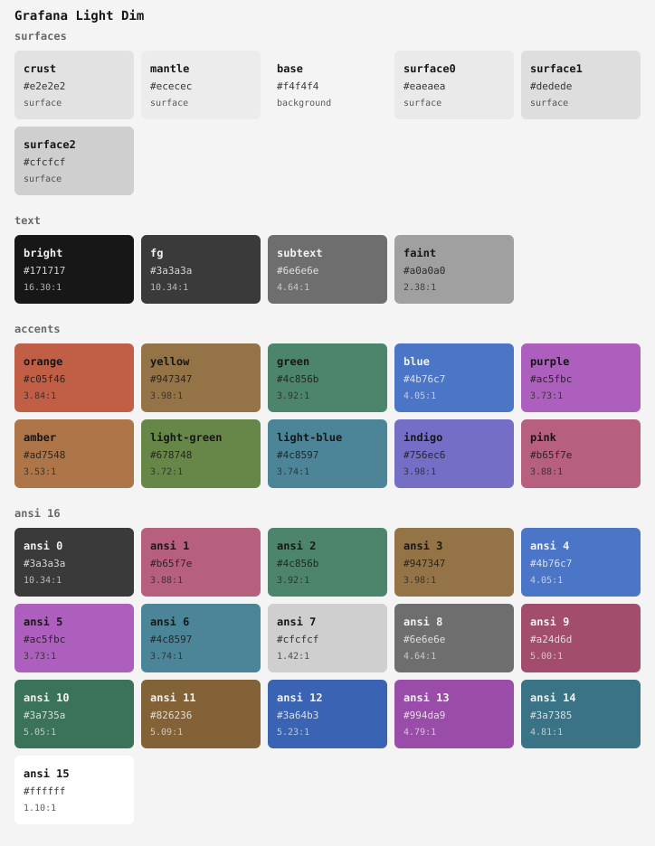
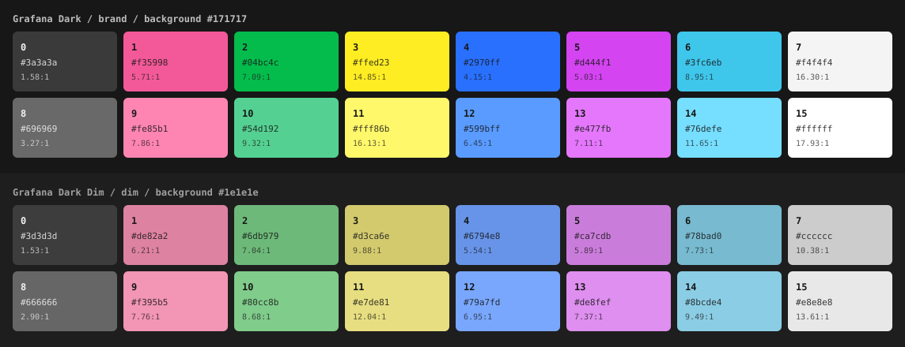

# Grafana color scheme

One palette, built on the Grafana Labs brand colors, ported to 14 tools.
The primary orange and the secondary yellow, green, blue and purple carry
the syntax, on the brand's own neutral canvas. A softer **Dim** flavor is
derived from it.









[](LICENSE)

> **Not an official Grafana Labs project.** "Grafana" is a trademark of
> Grafana Labs; this repository is an independent port of their brand palette
> and is not affiliated with or endorsed by them. See [NOTICE](NOTICE).

## About

Two variants in two flavors: `grafana-dark` and `grafana-light` (brand),
plus `grafana-dark-dim` and `grafana-light-dim` (dim). All four are generated
from a single
source of truth ([`palette.toml`](palette.toml)) by one dependency-free
script. The generated files are committed, so you can download the one file
your tool needs and never run anything.

The scheme started life as the syntax highlighting for
[www.ymotongpoo.com](https://www.ymotongpoo.com) and was generalized from
there.

## Palette

### Base colors

Taken verbatim from the Grafana Labs brand guide. These are never edited to
fix a contrast problem; the variants are.

<!-- BEGIN GENERATED: brand -->
| brand color   | hex       | group     |
|---------------|-----------|-----------|
| `orange`      | `#ff671d` | primary   |
| `white`       | `#ffffff` | secondary |
| `black`       | `#000000` | secondary |
| `yellow`      | `#ffed23` | secondary |
| `green`       | `#04bc4c` | secondary |
| `blue`        | `#2970ff` | secondary |
| `purple`      | `#d444f1` | secondary |
| `amber`       | `#ffab29` | support   |
| `light-green` | `#91d441` | support   |
| `light-blue`  | `#3fc6eb` | support   |
| `indigo`      | `#7d64ff` | support   |
| `pink`        | `#f35998` | support   |
| `neutral-1`   | `#f4f4f4` | neutral   |
| `neutral-2`   | `#afafaf` | neutral   |
| `neutral-3`   | `#696969` | neutral   |
| `neutral-4`   | `#3a3a3a` | neutral   |
| `neutral-5`   | `#171717` | neutral   |
<!-- END GENERATED: brand -->

The brand also publishes tint and shade ladders for five hues. The light
variant draws most of its accents from the 140–180% steps.

<!-- BEGIN GENERATED: ladders -->
| hue      | 20%       | 40%       | 60%       | 80%       | 100%      | 120%      | 140%      | 160%      | 180%      |
|----------|-----------|-----------|-----------|-----------|-----------|-----------|-----------|-----------|-----------|
| `orange` | `#fee9d4` | `#ffd0a7` | `#ffad70` | `#ff8137` | `#ff671d` | `#f04205` | `#c72f07` | `#9d250e` | `#7f230f` |
| `yellow` | `#fcffd2` | `#fffea8` | `#fff86b` | `#feed55` | `#fbe136` | `#fdc809` | `#cf9304` | `#aa710e` | `#915d14` |
| `green`  | `#d7f9e3` | `#aaf0c7` | `#72e1a6` | `#54d192` | `#18b16a` | `#0c9065` | `#0b7347` | `#0a5b39` | `#084b31` |
| `blue`   | `#d9e7ff` | `#bbd8ff` | `#8dc0ff` | `#599bff` | `#2870ff` | `#1b55f5` | `#1540e0` | `#1734b6` | `#1a308f` |
| `purple` | `#f9e8fe` | `#f3ceff` | `#eeaafd` | `#e477fb` | `#d444f0` | `#bb23d5` | `#9d1ab1` | `#831790` | `#6e1976` |
<!-- END GENERATED: ladders -->

Two things worth knowing about the source data:

- **The 100% step of a ladder is not always the secondary color of the same
  name.** The guide lists green as `#04bc4c` but centers its ladder on
  `#18b16a`; yellow is `#ffed23` against a ladder center of `#fbe136`; blue
  and purple differ in the last digit. Both sets are reproduced faithfully in
  `palette.toml`, and the ladders are what the variants are built from.
- **There is no red.** See [below](#there-is-no-red).

### Derivation

The default **brand** flavor puts the brand guide's colors on the brand's
own canvas:

- **Dark** uses Neutral 5 (`#171717`) for the background, white and the
  neutrals for text, and every primary, secondary and support color
  **verbatim**.
- **Light** uses white for the background and black / Neutral 5 for text.
  Blue, purple and indigo are verbatim. Orange, yellow and green use the
  brand's own darker ladder steps (120% / 160% / 120%); amber, light green,
  light blue and pink are too pale for white, so they are darkened in OKLCH
  with hue and chroma kept.

The most frequent syntax goes to the primary and secondary colors: orange
keywords, blue functions, green strings, yellow types and purple constants.

The **dim** flavor is derived from brand in OKLCH: each accent keeps its
hue, its chroma drops to 60%, and its lightness moves toward a common level.
The background moves one step off the brand extremes (`#1e1e1e` /
`#f4f4f4`) and text is softened to match.

Reading palettes have no minimum contrast requirement. See
[docs/derivation.md](docs/derivation.md) for the details.

### Dark

<!-- BEGIN GENERATED: palette-dark -->
| token         | brand     | origin    | on `#171717` | dim       | on `#1e1e1e` |
|---------------|-----------|-----------|--------------|-----------|--------------|
| `orange`      | `#ff671d` | primary   | 6.16:1       | `#e48a67` | 6.45:1       |
| `yellow`      | `#ffed23` | secondary | 14.85:1      | `#d3ca6e` | 9.88:1       |
| `green`       | `#04bc4c` | secondary | 7.09:1       | `#6db979` | 7.04:1       |
| `blue`        | `#2970ff` | secondary | 4.15:1       | `#6794e8` | 5.54:1       |
| `purple`      | `#d444f1` | secondary | 5.03:1       | `#ca7cdb` | 5.89:1       |
| `amber`       | `#ffab29` | support   | 9.48:1       | `#dbaa6d` | 7.92:1       |
| `light-green` | `#91d441` | support   | 9.99:1       | `#9ac274` | 8.21:1       |
| `light-blue`  | `#3fc6eb` | support   | 8.95:1       | `#78bad0` | 7.73:1       |
| `indigo`      | `#7d64ff` | support   | 4.39:1       | `#928ce7` | 5.66:1       |
| `pink`        | `#f35998` | support   | 5.71:1       | `#de82a2` | 6.21:1       |
<!-- END GENERATED: palette-dark -->

### Light

<!-- BEGIN GENERATED: palette-light -->
| token         | brand     | origin                | on `#ffffff` | dim       | on `#f4f4f4` |
|---------------|-----------|-----------------------|--------------|-----------|--------------|
| `orange`      | `#f04205` | orange 120%           | 3.83:1       | `#c05f46` | 3.84:1       |
| `yellow`      | `#aa710e` | yellow 160%           | 4.14:1       | `#947347` | 3.98:1       |
| `green`       | `#0c9065` | green 120%            | 4.04:1       | `#4c856b` | 3.92:1       |
| `blue`        | `#2970ff` | secondary             | 4.32:1       | `#4b76c7` | 4.05:1       |
| `purple`      | `#d444f1` | secondary             | 3.56:1       | `#ac5fbc` | 3.73:1       |
| `amber`       | `#d6760b` | amber; darkened       | 3.25:1       | `#ad7548` | 3.53:1       |
| `light-green` | `#5f940e` | light green; darkened | 3.67:1       | `#678748` | 3.72:1       |
| `light-blue`  | `#0a92b1` | light blue; darkened  | 3.65:1       | `#4c8597` | 3.74:1       |
| `indigo`      | `#7d64ff` | support               | 4.09:1       | `#756ec6` | 3.98:1       |
| `pink`        | `#e14889` | pink; darkened        | 3.83:1       | `#b65f7e` | 3.88:1       |
<!-- END GENERATED: palette-light -->

### Surfaces and text

Surfaces are **two ladders diverging from `base`**, not one chain:

- shadow: `base` → `mantle` → `crust`
- elevation: `base` → `surface0` → `surface1` → `surface2`

In the light variant this matters — `mantle` is lighter than `surface0`, and
`crust` sits between `surface0` and `surface1` — so treating the six as a
single ordering will give you the wrong answer.

<!-- BEGIN GENERATED: surfaces -->
| token      | dark brand          | dark dim            | light brand         | light dim           |
|------------|---------------------|---------------------|---------------------|---------------------|
| `crust`    | `#0b0b0b`           | `#121212`           | `#e9e9e9`           | `#e2e2e2`           |
| `mantle`   | `#111111`           | `#181818`           | `#f4f4f4`           | `#ececec`           |
| `base`     | `#171717`           | `#1e1e1e`           | `#ffffff`           | `#f4f4f4`           |
| `surface0` | `#212121`           | `#262626`           | `#f2f2f2`           | `#eaeaea`           |
| `surface1` | `#2c2c2c`           | `#303030`           | `#e6e6e6`           | `#dedede`           |
| `surface2` | `#3a3a3a`           | `#3d3d3d`           | `#d6d6d6`           | `#cfcfcf`           |
| `bright`   | `#ffffff` (17.93:1) | `#e8e8e8` (13.61:1) | `#000000` (21.00:1) | `#171717` (16.30:1) |
| `fg`       | `#f4f4f4` (16.30:1) | `#cccccc` (10.38:1) | `#171717` (17.93:1) | `#3a3a3a` (10.34:1) |
| `subtext`  | `#afafaf` (8.17:1)  | `#8f8f8f` (5.15:1)  | `#696969` (5.49:1)  | `#6e6e6e` (4.64:1)  |
| `faint`    | `#696969` (3.27:1)  | `#666666` (2.90:1)  | `#afafaf` (2.19:1)  | `#a0a0a0` (2.38:1)  |
<!-- END GENERATED: surfaces -->

### Semantic roles

Every port maps its own token names onto these roles, so changing a role here
changes all 14 targets at once. The `token` column is the palette color the
role points at.

<!-- BEGIN GENERATED: roles -->
| role                 | token        | dark brand | dark dim  | light brand | light dim | style         |
|----------------------|--------------|------------|-----------|-------------|-----------|---------------|
| `keyword`            | `orange`     | `#ff671d`  | `#e48a67` | `#f04205`   | `#c05f46` | -             |
| `keyword-ctrl`       | `orange`     | `#ff671d`  | `#e48a67` | `#f04205`   | `#c05f46` | -             |
| `keyword-op`         | `orange`     | `#ff671d`  | `#e48a67` | `#f04205`   | `#c05f46` | -             |
| `operator`           | `orange`     | `#ff671d`  | `#e48a67` | `#f04205`   | `#c05f46` | -             |
| `builtin`            | `amber`      | `#ffab29`  | `#dbaa6d` | `#d6760b`   | `#ad7548` | -             |
| `decorator`          | `amber`      | `#ffab29`  | `#dbaa6d` | `#d6760b`   | `#ad7548` | -             |
| `string`             | `green`      | `#04bc4c`  | `#6db979` | `#0c9065`   | `#4c856b` | -             |
| `string-doc`         | `green`      | `#04bc4c`  | `#6db979` | `#0c9065`   | `#4c856b` | italic        |
| `string-escape`      | `amber`      | `#ffab29`  | `#dbaa6d` | `#d6760b`   | `#ad7548` | -             |
| `regex`              | `pink`       | `#f35998`  | `#de82a2` | `#e14889`   | `#b65f7e` | -             |
| `number`             | `purple`     | `#d444f1`  | `#ca7cdb` | `#d444f1`   | `#ac5fbc` | -             |
| `boolean`            | `purple`     | `#d444f1`  | `#ca7cdb` | `#d444f1`   | `#ac5fbc` | -             |
| `constant`           | `purple`     | `#d444f1`  | `#ca7cdb` | `#d444f1`   | `#ac5fbc` | -             |
| `type`               | `yellow`     | `#ffed23`  | `#d3ca6e` | `#aa710e`   | `#947347` | -             |
| `class`              | `yellow`     | `#ffed23`  | `#d3ca6e` | `#aa710e`   | `#947347` | -             |
| `namespace`          | `yellow`     | `#ffed23`  | `#d3ca6e` | `#aa710e`   | `#947347` | -             |
| `interface`          | `yellow`     | `#ffed23`  | `#d3ca6e` | `#aa710e`   | `#947347` | -             |
| `function`           | `blue`       | `#2970ff`  | `#6794e8` | `#2970ff`   | `#4b76c7` | -             |
| `method`             | `blue`       | `#2970ff`  | `#6794e8` | `#2970ff`   | `#4b76c7` | -             |
| `variable`           | `fg`         | `#f4f4f4`  | `#cccccc` | `#171717`   | `#3a3a3a` | -             |
| `parameter`          | `fg`         | `#f4f4f4`  | `#cccccc` | `#171717`   | `#3a3a3a` | -             |
| `property`           | `light-blue` | `#3fc6eb`  | `#78bad0` | `#0a92b1`   | `#4c8597` | -             |
| `attribute`          | `amber`      | `#ffab29`  | `#dbaa6d` | `#d6760b`   | `#ad7548` | -             |
| `tag`                | `orange`     | `#ff671d`  | `#e48a67` | `#f04205`   | `#c05f46` | -             |
| `label`              | `amber`      | `#ffab29`  | `#dbaa6d` | `#d6760b`   | `#ad7548` | -             |
| `preprocessor`       | `indigo`     | `#7d64ff`  | `#928ce7` | `#7d64ff`   | `#756ec6` | -             |
| `punctuation`        | `subtext`    | `#afafaf`  | `#8f8f8f` | `#696969`   | `#6e6e6e` | -             |
| `comment`            | `subtext`    | `#afafaf`  | `#8f8f8f` | `#696969`   | `#6e6e6e` | italic        |
| `comment-doc`        | `subtext`    | `#afafaf`  | `#8f8f8f` | `#696969`   | `#6e6e6e` | italic        |
| `link`               | `light-blue` | `#3fc6eb`  | `#78bad0` | `#0a92b1`   | `#4c8597` | underline     |
| `heading`            | `orange`     | `#ff671d`  | `#e48a67` | `#f04205`   | `#c05f46` | bold          |
| `deprecated`         | `faint`      | `#696969`  | `#666666` | `#afafaf`   | `#a0a0a0` | strikethrough |
| `diagnostic.error`   | `pink`       | `#f35998`  | `#de82a2` | `#e14889`   | `#b65f7e` | -             |
| `diagnostic.warning` | `amber`      | `#ffab29`  | `#dbaa6d` | `#d6760b`   | `#ad7548` | -             |
| `diagnostic.info`    | `blue`       | `#2970ff`  | `#6794e8` | `#2970ff`   | `#4b76c7` | -             |
| `diagnostic.hint`    | `subtext`    | `#afafaf`  | `#8f8f8f` | `#696969`   | `#6e6e6e` | -             |
| `diagnostic.ok`      | `green`      | `#04bc4c`  | `#6db979` | `#0c9065`   | `#4c856b` | -             |
| `diff.added`         | `green`      | `#04bc4c`  | `#6db979` | `#0c9065`   | `#4c856b` | -             |
| `diff.removed`       | `pink`       | `#f35998`  | `#de82a2` | `#e14889`   | `#b65f7e` | -             |
| `diff.changed`       | `yellow`     | `#ffed23`  | `#d3ca6e` | `#aa710e`   | `#947347` | -             |
<!-- END GENERATED: roles -->

See [docs/roles.md](docs/roles.md) for the reasoning behind individual
assignments.

### ANSI 16

The single highest-leverage table in the repo: WezTerm, iTerm2, tmux, Zed's
`terminal.ansi.*`, VS Code's `terminal.ansi*`, Vim's `g:terminal_ansi_colors`,
Herdr's `terminal` mode and Orca's terminal themes all consume it.

<!-- BEGIN GENERATED: ansi -->
| slot | name           | dark brand | dark dim  | light brand | light dim |
|------|----------------|------------|-----------|-------------|-----------|
| 0    | black          | `#3a3a3a`  | `#3d3d3d` | `#171717`   | `#3a3a3a` |
| 1    | red            | `#f35998`  | `#de82a2` | `#e14889`   | `#b65f7e` |
| 2    | green          | `#04bc4c`  | `#6db979` | `#0c9065`   | `#4c856b` |
| 3    | yellow         | `#ffed23`  | `#d3ca6e` | `#aa710e`   | `#947347` |
| 4    | blue           | `#2970ff`  | `#6794e8` | `#2970ff`   | `#4b76c7` |
| 5    | magenta        | `#d444f1`  | `#ca7cdb` | `#d444f1`   | `#ac5fbc` |
| 6    | cyan           | `#3fc6eb`  | `#78bad0` | `#0a92b1`   | `#4c8597` |
| 7    | white          | `#f4f4f4`  | `#cccccc` | `#d6d6d6`   | `#cfcfcf` |
| 8    | bright black   | `#696969`  | `#666666` | `#696969`   | `#6e6e6e` |
| 9    | bright red     | `#fe85b1`  | `#f395b5` | `#c82e74`   | `#a24d6d` |
| 10   | bright green   | `#54d192`  | `#80cc8b` | `#0b7347`   | `#3a735a` |
| 11   | bright yellow  | `#fff86b`  | `#e7de81` | `#915d14`   | `#826236` |
| 12   | bright blue    | `#599bff`  | `#79a7fd` | `#1b55f5`   | `#3a64b3` |
| 13   | bright magenta | `#e477fb`  | `#de8fef` | `#bb23d5`   | `#994da9` |
| 14   | bright cyan    | `#76defe`  | `#8bcde4` | `#077b96`   | `#3a7385` |
| 15   | bright white   | `#ffffff`  | `#e8e8e8` | `#f4f4f4`   | `#ffffff` |
<!-- END GENERATED: ansi -->



Dark and light have different ANSI mappings. Slot 0 must differ from the
background. Brand brights 9–14 take the next brand ladder step where one
exists (80% on dark, 120%–180% on light); pink and light blue have no ladder,
so they move OKLCH lightness instead. Dim brights move the dim accents'
lightness the same way.

### There is no red

The Grafana brand palette has no red. Rather than invent one, the roles that
conventionally want red are mapped onto colors the brand does have:

| role | mapped to | why |
|---|---|---|
| `error`, `diff.removed`, `regex` | `pink` | the most red-adjacent brand hue, and distinct from `orange` at every step of both ladders |
| `warning` | `amber` | already the brand's caution color |

The one place this leaks is Herdr, whose token vocabulary hard-codes the name
`red`; that file sets `red` to our pink and says so in a comment.

### Browser chrome

The Chrome theme does not use the syntax accents. Browser chrome is a
branding surface, so `[variants.*.browser]` carries a separate `key` /
`key_alt` / `key_accent` / `on_key` set: the undimmed brand orange goes on
the frame and toolbar, and `on_key` flips to whichever of near-black or
white clears AA on top of it. See
[targets/chrome/README.md](targets/chrome/README.md).

### Palette checks

Reading palettes have no WCAG minimum contrast requirement; the ratios in
these tables describe the colors, rather than acting as pass/fail thresholds.
Chrome retains its separate browser contrast checks.

`python3 tools/generate.py --verify` checks both flavors for valid colors,
resolved roles, complete ANSI tables, and ordered surface ladders. It also
requires accents to remain at least CIE76 ΔE 8 apart, so adjacent hues retain
some separation after dimming. These rules live in `palette.toml`.

## Install

<!-- BEGIN GENERATED: install -->
| tool          | files                                | artifacts                                                      | install                                                                                 |
|---------------|--------------------------------------|----------------------------------------------------------------|-----------------------------------------------------------------------------------------|
| ChatGPT macOS | [`targets/chatgpt`](targets/chatgpt) | 4 Codex theme import strings + CC Theme package                | paste the matching `*.codex-theme.txt` string into Codex Settings > Appearance > Import |
| VS Code       | [`targets/vscode`](targets/vscode)   | extension root with 4 theme files                              | symlink `targets/vscode` into `~/.vscode/extensions/`, restart, then pick the theme     |
| Zed           | [`targets/zed`](targets/zed)         | 1 theme family (4 themes)                                      | copy `themes/grafana.json` to `~/.config/zed/themes/`                                   |
| T3 Code       | [`targets/t3code`](targets/t3code)   | 2 importable theme files, each with light and dark appearances | Settings → Appearance → Import theme, then choose `grafana.json` or `grafana-dim.json`  |
| Orca IDE      | [`targets/orca`](targets/orca)       | 1 plugin with 4 app/editor and 4 terminal themes               | run `orca plugin install ./targets/orca` on Orca Desktop, then pick the theme           |
| Emacs         | [`targets/emacs`](targets/emacs)     | 4 theme files                                                  | add the directory to `custom-theme-load-path`, then `(load-theme 'grafana-dark t)`      |
| Vim / Neovim  | [`targets/vim`](targets/vim)         | 4 colorschemes                                                 | add `targets/vim` to `runtimepath`, then `:colorscheme grafana-dark`                    |
| WezTerm       | [`targets/wezterm`](targets/wezterm) | 4 TOML schemes                                                 | copy `colors/*.toml` to `~/.config/wezterm/colors/`, then set `color_scheme`            |
| iTerm2        | [`targets/iterm2`](targets/iterm2)   | 4 color presets                                                | Settings > Profiles > Colors > Color Presets > Import                                   |
| tmux          | [`targets/tmux`](targets/tmux)       | 4 themes, optional status lines, TPM entry point               | `source-file` the conf from `~/.tmux.conf`, or install via TPM                          |
| Herdr         | [`targets/herdr`](targets/herdr)     | 6 config fragments (2 auto-switching)                          | paste the `[theme.custom]` block into `~/.config/herdr/config.toml`                     |
| Chroma / Hugo | [`targets/chroma`](targets/chroma)   | 4 XML styles, 6 stylesheets                                    | Hugo: copy a CSS file and set `markup.highlight.noClasses = false`                      |
| Slack         | [`targets/slack`](targets/slack)     | 4 sidebar strings                                              | Preferences > Themes, paste the string into the custom theme field                      |
| Chrome        | [`targets/chrome`](targets/chrome)   | 2 unpacked themes (brand only)                                 | `chrome://extensions` > Developer mode > Load unpacked                                  |
<!-- END GENERATED: install -->

Each directory has its own README with the full steps and any per-tool
caveats. The directories are shaped the way each tool expects, so
`targets/vim` works as a `runtimepath` entry, `targets/vscode` as an
extension root, and so on.

## Flavors

Every target except Chrome ships both flavors:

- **brand** (the default, unsuffixed: `grafana-dark`, `Grafana Dark`) uses
  the brand colors as described above.
- **dim** (`-dim` / `Dim`: `grafana-dark-dim`, `Grafana Dark Dim`) is the
  same design at lower saturation, for long reading sessions.

Both flavors use the same semantic roles, so switching between them changes
the intensity, not where each color goes. Chrome's frame is a branding
surface and ships the brand flavor only.

The earlier warm gray palette (unsuffixed) and the `-vivid` terminal flavor
have been retired; the unsuffixed names now point at the brand flavor.

## Regenerate

```sh
python3 tools/generate.py            # rewrite every target and the doc tables
python3 tools/generate.py --verify   # palette invariants and browser contrast
python3 tools/generate.py --check    # fail if anything on disk is stale
python3 tools/generate.py --list     # registered targets
python3 -m unittest discover -s tools/tests  # flavor regression tests
```

Requires Python 3.11 or newer (for `tomllib`) and nothing else.

**Never hand-edit anything under `targets/`** — edit `palette.toml` and
regenerate. `--check` reports staleness, missing files and orphans left
behind by renames.

Adding a twelfth target is three steps; see
[docs/adding-a-target.md](docs/adding-a-target.md).

## Roadmap

- CI running `--check` and `--verify` on every push
- Submit the `.itermcolors` to
  [mbadolato/iTerm2-Color-Schemes](https://github.com/mbadolato/iTerm2-Color-Schemes),
  which auto-generates ~40 more formats and is where WezTerm syncs its
  bundled schemes from
- Upstream `styles/grafana-*.xml` to
  [alecthomas/chroma](https://github.com/alecthomas/chroma), which would let
  Hugo select the style by name and make the bundled CSS unnecessary
- Upstream the palette to Herdr's built-in theme list
- A Neovim Lua module, plus Alacritty / Ghostty / Kitty / Helix
- Screenshots of real editors

Marketplace publishing (VS Code Marketplace, Open VSX, Chrome Web Store, Zed
extensions) is deliberately out of scope for now: a store listing under the
Grafana name is a different trademark question than a GitHub repository.

## License

[Apache License 2.0](LICENSE). See [NOTICE](NOTICE) for attribution and the
trademark disclaimer.
